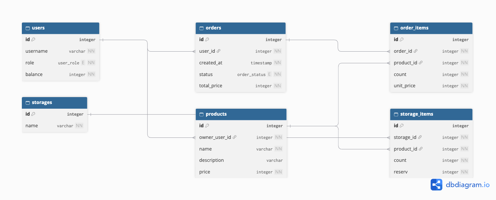
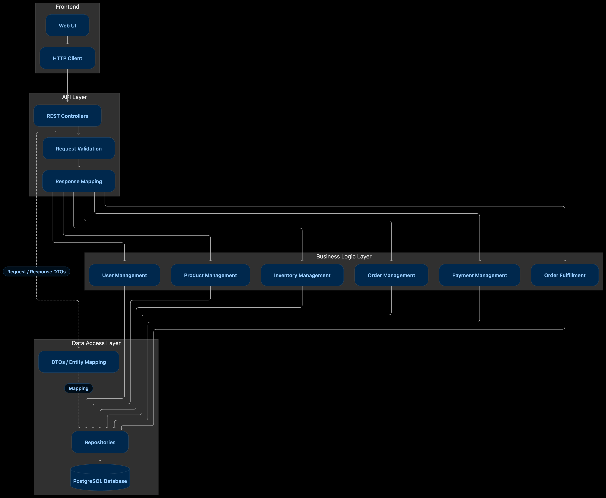

# OrderFlow

**OrderFlow** is a B2C e-commerce backend application designed to manage products, inventory, orders, and payments.

The project is being developed as a learning and portfolio project, with a focus on Java backend development, database design, business logic, and reliable data management.

## Features

- User accounts and role-based access (`ADMIN`, `USER`)
- Product catalog management
- Multiple warehouses and inventory tracking
- Stock reservation during order creation
- Order lifecycle management
- Internal user balance and simulated payments
- Automatic expiration of unpaid orders
- Order cancellation and refund handling

## Tech Stack

*Planned technologies:*

- **Language:** Java
- **Framework:** Spring Boot
- **Database:** PostgreSQL
- **ORM:** Spring Data JPA / Hibernate
- **Database migrations:** Flyway
- **Build tool:** Maven
- **Testing:** JUnit 5, Mockito
- **Containerization:** Docker

## Database Design

The database schema is designed around users, products, orders, inventory, and warehouse management.

### ER Diagram

<!-- Insert database schema diagram here -->

## Application Architecture

The application is planned as a modular monolith with separated business logic, API, and data access layers.

### Architecture Diagram

<!-- Insert application architecture diagram here -->

## Project Structure

*To be updated as the application develops.*

## Development Roadmap

- [x] Initial database schema design
- [x] Set up Spring Boot application
- [x] Configure PostgreSQL and Flyway
- [ ] Implement user management and authentication
- [ ] Implement product catalog
- [ ] Implement warehouse and inventory management
- [ ] Implement order creation and stock reservation
- [ ] Implement payments and balance management
- [ ] Implement order cancellation and refunds
- [ ] Implement automatic expiration of unpaid orders
- [ ] Add unit and integration tests
- [ ] Dockerize the application

## Project Status

<ins>In Development</ins>

The project is under active development. Features, architecture, and database design may evolve as implementation progresses.</ins>

## License

To be determined.
